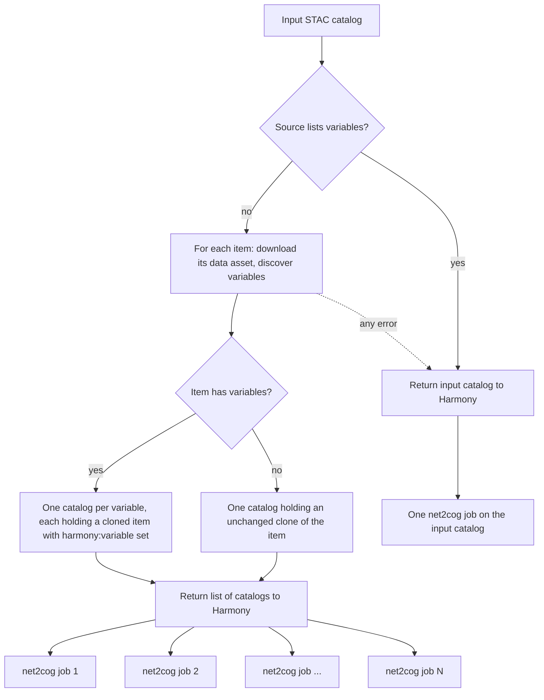

# Harmony Variable Fan Out Service

This repository contains code for the harmony-variable-fan-out-service.

This service fans out request to net2cog. It takes a request for `all` variables, and transforms it into N requests, each for a single variable, letting harmony fan it out into N parallel requests.

The basic idea for a request for all variables headed to net2cog is that the STAC Catalog's Item data asset is downloaded and net2cog's `get_all_data_variables` function is used to determine a list of variables that net2cog can process.  For every variable found, the input catalog is cloned and the Item updated with a new property `harmony:variable` whose value is the variable name.  This list of catalogs is returned to harmony, which treats them as a batch catalog and submits them to net2cog downstream.  Net2cog has been updated to look for this new `harmony:variable` property and only process the single variable found there.

The details are a little grittier to handle multiple Items in a Catalog and mixed catalogs with Items that have variables and items that don't. Those details are shown here (or in the code).


## Contributing

Contributions are welcome! For more information, see `CONTRIBUTING.md`.

## Command line invocation

For examples on how to run from the command line, see the `README.md` in the `example` directory.


## Local development

Local testing of service functionality is best achieved via a local instance of [Harmony](https://github.com/nasa/harmony). Please see instructions there regarding creation of a local Harmony-In-A-Box instance.

Locally, running Harmony-In-A-Box, the fan out is off by default. Harmony's `services/harmony/env-defaults` sets `HARMONY_VARIABLE_FAN_OUT_ENABLED=false`, so the service passes every request through unchanged. The fan out would make local runs slower, because each downstream net2cog job downloads the granule again. To use the fan out locally, as deployed environments do, add `HARMONY_VARIABLE_FAN_OUT_ENABLED=true` to Harmony's `.env` and rerun `bin/deploy-services`. Harmony gives the service container every env var whose name starts with `HARMONY_VARIABLE_FAN_OUT`. If the variable is unset, the service fans out.

If testing small functions locally that do not require inputs from the main Harmony application, it is recommended that you create a Python virtual environment via uv, and install the necessary dependencies for the service within that environment.

```bash
uv sync
uv run pytest
```

## Tests

This service utilizes the Python `pytest` package to perform unit tests on classes and functions in the service. After local development is complete, and tests have been updated, they can be run via:

```bash
$ ./bin/build-image && ./bin/build-test && ./bin/run-test
```

Chain the commands with `&&` so that a failed build stops the sequence.

The `./bin/run-test` command runs the script `tests/run_tests.sh` in the docker test container. It will run the unit tests and generate a coverage report rendered in HTML and place them in `reports/test-reports/` and `reports/coverage/`.


The `pytest` suite is run automatically within a GitHub workflow as part of a CI/CD pipeline. These tests are run for all changes made in a PR against the `main` branch. The tests must pass in order to merge the PR.

## `pre-commit` hooks

This repository uses [pre-commit](https://pre-commit.com/) to enforce checks that coding standard best practices are followed.
a .pre-commit-config.yaml file is set in the rood directory and GitHub is configured to run the checks automatically to:

* Removes trailing whitespaces.
* Removes blank lines at the end of a file.
* Ensure JSON, YAML, and TOML files have valid formats.
* Ensures no merge markers left in the files.
* Refuses to check in files greater than 500 kb.
* Runs python linting and formatting via [ruff](https://github.com/astral-sh/ruff).

You should enable these pre-commit hooks locally so your commits arrive on GitHub in the proper format:

```bash
uv sync
uv run pre-commit install
```

## Versioning

Docker service images for the `harmony-variable-fan-out` service adhere to [semantic version](https://semver.org/) numbers: major.minor.patch.

* Major increments: These are non-backwards compatible API changes.
* Minor increments: These are backwards compatible API changes.
* Patch increments: These updates do not affect the API to the service.

## CI/CD

The CI/CD for Harmony-variable-fan-out Service is run on github actions with the workflows in the `.github/workflows` directory:

* `run_tests.yml` - A reusable workflow that builds the service and test Docker images, then runs the Python unit test suite in an instance of the test Docker container.
* `run_tests_on_pull_requests.yml` - Triggered for all PRs against the `main` branch. It runs the workflow in `run_tests.yml` to ensure all tests pass for the new code.
* `publish_release.yml`<a name="release-workflow"></a> - workflow runs automatically when there is a change to the `docker/service_version.txt` file on the main branch.  This workflow will:
    * Run the full unit test suite, to prevent publication of broken code.
    * Extract the semantic version number from `docker/service_version.txt`.
    * Extract the release notes for the most recent version from `CHANGELOG.md`.
    * Build and deploy this service's docker image to `ghcr.io`.
    * Publish a GitHub release under the semantic version number, with associated git tag.

## Releasing

A release consists of a new Docker image for the Harmony-variable-Fan-Out Service published to GitHub's container repository (`ghcr.io/nasa/harmony-variable-fan-out`).

A release is made automatically when a commit to the `main` branch contains changes to the `docker/service_version.txt` file, see the [publish_release](#release-workflow) workflow in the CI/CD section above.

Before **merging** a PR that will trigger a release, ensure these two files are updated:

* `CHANGELOG.md` - Notes should be added to capture the changes to the service and a link to the expected tag created by the merge should be included.

* `docker/service_version.txt` - The semantic version number should be updated to trigger the release.

The `CHANGELOG.md` file requires a specific format for a new release, as it looks for the following string to define the newest release of the code (starting at the top of the file).

```
## [vX.Y.Z] - YYYY-MM-DD
```

And in the footer of the file, the markdown reference needs to be updated following the existing pattern.
```
[vX.Y.Z]: https://github.com/nasa/harmony-variable-fan-out/releases/tag/X.Y.Z
```
